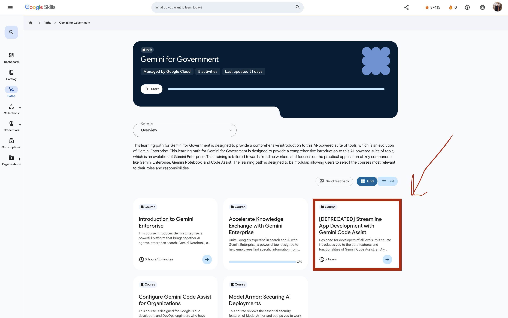

## Perkenalan Fasilitator

Pendamping Anda dalam perjalanan belajar GCSB

{width=2.2in}

**Fadhel Muhammad Apriansyah**  
**GCSB Facilitator**

Saya siap mendampingi peserta dalam memahami learning pathway, menavigasi Google Skills Platform, menyelesaikan hands-on lab, dan menjaga progress pembelajaran tetap terarah.

[https://www.linkedin.com/in/fadhel-muhammad-apriansyah/](https://www.linkedin.com/in/fadhel-muhammad-apriansyah/)

## Learning Pathways (Fokus Utama: AI & Cybersecurity)

Benchmark penyelesaian: **10–20 jam pembelajaran**

### Jalur Cybersecurity

- [GCP Cloud Security Fundamentals](https://www.skills.google/paths/4942)
- [Network Security & Perimeter Defense](https://www.skills.google/paths/4943)
- [Identity, Access & Data Protection](https://www.skills.google/paths/4944)
- [Application & Container Security (DevSecOps)](https://www.skills.google/paths/4945)
- [Security Operations (SecOps) & Incident Response](https://www.skills.google/paths/4946)

### Jalur AI (Generative AI on GCP)

- [Gemini Enterprise and Gemini Notebook](https://www.skills.google/paths/3666)
- [Gemini for Government](https://www.skills.google/paths/2919)
- [Gemini Enterprise for Customer Experience](https://www.skills.google/paths/3180)

### Jalur Cybersecurity (Additional Course)

- [Beginner: Google Cloud Cybersecurity Certificate](https://www.skills.google/paths/419)
- [Google Security Operations](https://www.skills.google/paths/581)
- [Professional Security Engineer Certification](https://www.skills.google/paths/15)
- [Professional Security Operations Engineer Certification](https://www.skills.google/paths/2150)
- [Network Security](https://www.skills.google/paths/1839)
- [Govern and Secure Enterprise Agents](https://www.skills.google/paths/4461)

### Jalur AI (Additional Course)

- [Gemini in BigQuery](https://www.skills.google/paths/1803)
- [Google Workspace with Gemini](https://www.skills.google/paths/249)
- [Gemini for Financial Services](https://www.skills.google/paths/4864)
- [Gemini for Legal](https://www.skills.google/paths/4869)
- [Professional Agentic Architect Certification](https://www.skills.google/paths/4525)

## Google Skills Platform Navigation

### Langkah Utama

- **Dashboard & Profil:** Pastikan akun Telkom Group terhubung dengan benar.
- **Course vs Hands-on Lab:** Bedakan materi teori dan lingkungan praktik (Sandbox).
- **Aturan Wajib Lab:** Gunakan Incognito/Private Window saat menekan “Start Lab”.
- **Progress & Badge:** Dapatkan Skill Badge setiap menyelesaikan satu Quest.

### Visual Orientasi Platform

- Dashboard GCSB: profil, learning progress, Quest, dan Skill Badge.
- Start Lab: buka Incognito, klik Start Lab, lalu ikuti instruksi.

## Skip Modul dengan Label [DEPRECATED]

Pastikan course yang dipilih masih aktif dan relevan.

{width=7.2in}

- Jika course memiliki label **[DEPRECATED]**, skip atau abaikan modul tersebut.
- Pilih course aktif yang tersedia pada daftar resmi GCSB.

## Learning Tips & Success Strategy

### Strategi Belajar

- **Time Blocking:** Jadwalkan waktu belajar spesifik setiap minggu untuk memenuhi target 10–20 jam.
- **Pahami Tujuan:** Baca tujuan pembelajaran dan selesaikan materi teori sebelum masuk lab.
- **Praktik Bertahap:** Kerjakan satu lab sampai selesai; ulangi lab yang gagal untuk memahami penyebabnya.
- **Catat Pembelajaran:** Simpan command, konsep, dan error penting sebagai referensi.
- **Check My Progress:** Klik tombol ini sebelum End Lab untuk memastikan nilai masuk (100/100).
- **Review Mingguan:** Cek badge dan progres; lengkapi Additional Course bila path AI di bawah 10 jam.

### Checklist Sebelum End Lab

1. Review instruksi.
2. Check My Progress sampai tampil 100/100.
3. End Lab setelah progress tersimpan.

## Demo Lab

## Q&A & Dukungan Program

### WA Community

Diskusi teknis, tanya jawab error lab, dan update progres bersama fasilitator.

### Helpdesk (CS Telkom CorpU)

Hubungi untuk kendala akses, aktivasi akun, atau akun GCSB yang ter-suspend.

Selanjutnya: sesi Q&A sesuai rundown.
